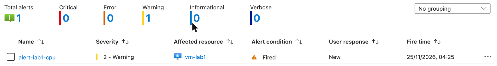

# Lab 1: Terraform on Azure with plan-on-PR

Status: both configurations pass validate. Bootstrap and infra applied; alert tested; clean clone and destroy pending. See `evidence/RESULTS.md`.

Provisions a small Linux VM, network, storage account and CPU alert. Pull requests run format, validate and plan. Apply is manual because CI only has read access.

## Layout

| Path | What it does |
|---|---|
| `bootstrap/` | Run once. Budget alert, remote state storage, read-only CI identity. Local state. |
| `infra/versions.tf` | Provider versions and remote state backend |
| `infra/variables.tf`, `outputs.tf` | Inputs and outputs |
| `infra/main.tf` | Resource group, tags, storage account |
| `infra/network.tf` | VNet, subnet, network interface (no public IP) |
| `infra/vm.tf` | Ubuntu VM |
| `infra/monitoring.tf` | Email action group and CPU alert |
| `.github/workflows/plan.yml` | Checks on every pull request |

## How to run

0. On a new subscription, register the providers once: `az provider register -n NAME` for Microsoft.Compute, Microsoft.Network, Microsoft.Storage, Microsoft.ManagedIdentity and microsoft.insights.
1. Install Terraform and Azure CLI, then `az login` and set `ARM_SUBSCRIPTION_ID` in your shell.
2. In `bootstrap/`, copy `terraform.tfvars.example` to `terraform.tfvars`, edit, then `terraform init`, `plan`, `apply`.
3. Add GitHub secrets `AZURE_CLIENT_ID`, `AZURE_TENANT_ID`, `AZURE_SUBSCRIPTION_ID`, `ALERT_EMAIL`, `SSH_PUBLIC_KEY` and variables `STATE_RESOURCE_GROUP`, `STATE_STORAGE_ACCOUNT`.
4. In `infra/`, copy both `.example` files without the suffix, edit, then `terraform init -backend-config=backend.hcl`, `plan`, `apply`.

## Test the CPU alert

The VM has no public IP, so load is started through the Azure control plane. Each load process stops by itself after 12 minutes.

```bash
az vm run-command invoke -g rg-lab1 -n vm-lab1 --command-id RunShellScript \
  --scripts 'for i in 1 2; do nohup timeout 720 sh -c "while :; do :; done" >/dev/null 2>&1 & done'
```

Check Azure Monitor > Alerts for `alert-lab1-cpu`. It fires when average CPU is above `cpu_threshold` (default 70) over 5 minutes.

## Results so far

| Item | Result |
|---|---|
| Bootstrap apply | 10 added |
| Infra apply | 9 added |
| Pull requests with passing checks | 3 of 3 |
| CPU alert | Fired 446 seconds after the load command |



## Cost control

- The budget is created first. It alerts but does not stop spending.
- All taggable resources carry `project = lab1-terraform`.
- When finished, review `terraform plan -destroy` in `infra/`, then run `terraform destroy`. Destroy `bootstrap/` last, because it holds the state.
- Prices and free limits vary by account and region. Check the portal before applying.
